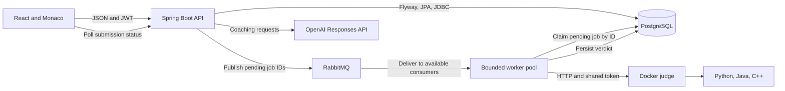

# CodeArena architecture

The API verifies a JWT signature and its expiry, then checks the current account, role, and token version in PostgreSQL. BCrypt protects stored passwords. Logout and password changes advance the account’s token version and invalidate its previous access tokens. Admin routes use backend role checks.

Submitting creates a durable pending record with test inputs and limits selected in the same transaction. An optional idempotency key scoped to the account returns the original submission for a repeated request. In RabbitMQ mode, the dispatcher scans committed jobs and publishes only their IDs to a durable queue. PostgreSQL row locks reserve the batch. Failed publishes become eligible after 15 seconds, and confirmed IDs still pending after three minutes are eligible again. The confirmation updates only the attempt that reserved the message.

Each RabbitMQ consumer handles one message at a time. A worker atomically claims the pending submission with a three-minute lease, then stores the result only if its attempt still owns the job. The listener acknowledges after processing or finding the job already claimed or finished. Recovery makes expired leases eligible for another attempt, up to three attempts. A pending job older than ten minutes becomes an internal error. Explicit judge capacity errors are retried with a short delay. A timed-out hosted POST can have been accepted, so the adapter does not immediately resend that request.

The judge compiles Java or C++ once per job and compares output tokens in order for each case. The worker stores sample output, aggregate case counts, and the verdict, then removes the job payload. Hidden inputs and outputs stay in the execution pipeline.

Sample runs and custom runs use the same queue but are excluded from scoring and submission history. Contest submissions require registration, a linked problem, and a currently open contest. Points are awarded once per solved contest problem. The penalty is elapsed minutes plus the configured penalty for incorrect attempts before the first accepted submission.

Compose runs two workers by default. It runs the judge as a non-root user on an internal network, with a read-only filesystem, writable temporary workspace, and container limits on memory and process count. The Compose judge is for trusted local code. On native Windows the judge uses a Job Object to cap memory and process count and terminate the process tree. Use the hosted gateway for public execution.

Without RabbitMQ enabled, the native worker pool claims eligible jobs directly from PostgreSQL. The native default is one worker. Completed Run jobs expire after seven days. Graded submissions remain in history.

With the `prod` profile, the API uses RabbitMQ over verified TLS and calls an authenticated hosted judge over HTTPS. It submits resource limits and disables sandbox networking in each job request. It compares outputs itself, filters results to visible tests, and enforces admission budgets in PostgreSQL. Cloud Run allocates CPU to the worker between HTTP requests. See the [deployment guide](deployment.md).

The catalog reads transactionally maintained judged and accepted counts. PostgreSQL holds skill completion and the latest saved plan per account and track. AI requests use the server’s OpenAI key and have per-account, application-wide, and per-instance concurrency limits. The practice coach sends public problem content and includes source code only for reviews. The server enforces coaching restrictions for individual problems and active contests. Career guidance uses the chosen track, its completed skills, and the learner’s form answers.
