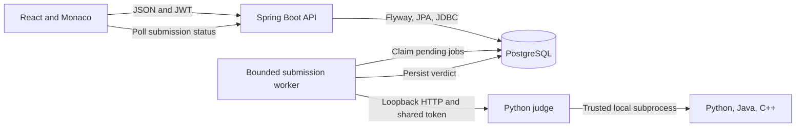

# CodeArena architecture

The API verifies a JWT signature and its expiry, then checks the current account, role, and token version in PostgreSQL. BCrypt protects stored passwords. Logout and password changes advance the account’s token version and invalidate its previous access tokens. Admin routes use backend role checks.

Submitting creates a durable pending record with the test inputs and limits selected in the same transaction. A single local worker claims it with PostgreSQL row locks and sends it to the separate judge. The judge compiles Java or C++ once per job and compares output tokens in order for each case. The worker stores sample output, aggregate case counts, and the verdict, then removes the job payload. Hidden inputs and outputs stay on the server.

Sample runs and custom runs use the same queue but are excluded from scoring and submission history. Contest submissions require registration, a linked problem, and a currently open contest. Points are awarded once per solved contest problem. The penalty is elapsed minutes plus the configured penalty for incorrect attempts before the first accepted submission.

On Windows the judge attaches a gated subprocess to a Job Object before releasing the compiler or program. The Job Object caps committed memory and process count and supports terminating the whole tree. This is a trusted local runner with the operating system account’s privileges. The gateway can be replaced with a hardened runner for public use.

Pending work survives API restarts. Running jobs that stop reporting become internal errors after three minutes. The first version uses one execution slot to fit a small development machine. The database queue and replaceable gateway allow a separate worker deployment later.

With the `prod` profile, the API calls an authenticated hosted judge over HTTPS. It submits resource limits and disables sandbox networking in each job request. It compares outputs itself, filters results to visible tests, and enforces admission budgets in PostgreSQL. Cloud Run allocates CPU to the worker between HTTP requests. See the [deployment guide](deployment.md).
